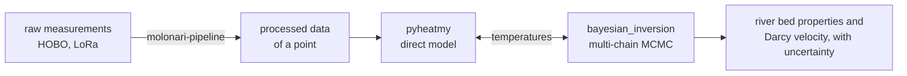

# MOLONARI-computo

**From temperatures measured in a river bed to the water flowing through it, with its uncertainty.**

A MOLONARI device records, in a river bed, the temperature at several depths (0 to about 40 cm) and the head
difference between the river and the aquifer. MOLONARI-computo turns these measurements into what they are for: the
properties of the river bed (permeability, thermal conductivity, porosity) and the **Darcy velocity**, the exchange
of water between the river and the aquifer, each with a **credible interval**, not a single value.

It does so in two steps:

1. **A direct model**, `pyheatmy`, computes the temperatures a river bed with given properties would show.
2. **A Bayesian inversion**, `bayesian_inversion`, searches the properties whose temperatures match the
   measurements, with a **multi-chain MCMC** (DREAM) that returns the whole posterior distribution.



## Start with the tutorials

The tutorials are the way in: three notebooks, in [MOLO-tuto-cmpt](https://github.com/flipoyo/MOLO-tuto-cmpt), that
run on the data committed with them.

| | Tutorial | What you do | Time |
|---|---|---|---|
| 1 | `01_generate_data.ipynb` | Build a virtual monitoring point whose properties **you choose**: boundary conditions, direct model, measurement noise. | seconds |
| 2 | `02_inversion.ipynb` | Recover those properties from the noisy temperatures with the multi-chain MCMC, then **check the result against the truth**: convergence, posterior, Darcy velocity. | about 4 min |
| 3 | `03_real_data.ipynb` | Invert the **real measurements** of the monitoring point Point034 (June–July 2016): fit before and after, posterior, Péclet number, how to read the result. | about 4 min |

Start with tutorial 2 if you want to see the method at work, and with tutorial 3 if you want to apply it to a point
of your own.

## What you can do with it

**Simulate a river bed** (`pyheatmy`). A `Column` is a stack of sediment layers between the river and the aquifer,
forced by your measured river temperature and head difference. It computes the transient head and temperature
profiles and the flow through every cell. `Column.simulate` is the direct model as a plain function of the layer
parameters.

**Estimate its properties with their uncertainty** (`bayesian_inversion`).
- Choose which parameters are estimated and which are fixed, and give each a prior range; the sampling scale (linear
  or logarithmic, for a permeability over several orders of magnitude) is picked from the range.
- Missing measurements are left out of the fit, and the noise level of the sensors can be fixed or estimated.
- Read the result as chains, quantiles (5 %, 50 %, 95 % by default), the state of lowest energy, and acceptance rates.

**Prepare the data** (`molonari-pipeline`). Raw HOBO exports and LoRa messages are turned, reproducibly, into the
processed files the direct model reads. Every processed point carries a manifest that proves the computation can be
replayed identically.

## Multi-chain MCMC

A single MCMC chain can wander, or settle in one corner of the parameter space without telling you. MOLONARI-computo
runs **several chains at once** (10 by default) with **DREAM** (Vrugt, 2016), in which each chain proposes its next
state from the differences between other chains. They share what they learn: the chains explore a long, narrow
posterior much faster than independent ones, and their disagreement tells you whether to trust the result.

```python
from bayesian_inversion import Prior, StateSpace, run_mcmc

space = StateSpace({"river bed": {"IntrinK":  Prior((1e-15, 1e-10), 1e-12),   # estimated
                                  "lambda_s": Prior((1.0, 5.0), 0.1),         # estimated
                                  "n":        Prior(0.1, 0),                  # fixed
                                  "rhos_cs":  Prior(4e6, 0),
                                  "q_s":      Prior(0.0, 0)}})
result = run_mcmc(column.simulate, column.get_measured_temperatures(), space,
                  nb_chain=10, nb_iter=300, seed=1)

result.chains()                        # every chain, iteration by iteration
result.quantiles["temperatures"][0.5]  # median temperatures of the posterior
result.best()                          # state of lowest energy
```

- **Automatic burn-in.** The warm-up stops by itself once the Gelman–Rubin statistic R̂ of every estimated parameter
  is at most 1.2, or after a maximum number of iterations, with a warning if R̂ has not been reached.
- **Convergence you can read.** R̂, the acceptance rate of each chain and the lowest energy of each chain are
  available, and tutorial 2 shows how to set aside a chain that stands apart from the others.
- **Reproducible.** `seed` seeds the random generators: the same run gives the same chains.
- **One chain if you prefer.** With `nb_chain=1`, the sampler is a random-walk Metropolis.
- **Any model.** The model given to `run_mcmc` is any function from parameters to outputs; `bayesian_inversion` does
  not import `pyheatmy`.

### Computing time

The cost of a run is the number of chains times the number of iterations, each iteration solving the direct model
once per chain: about four minutes for 10 chains and 300 iterations on a one-layer column of 100 cells (tutorials 2
and 3). In this release the chains of a run advance one after the other in a single process, so a run uses one core;
the chains are independent within an iteration, which is what makes the method a natural candidate for a cluster. To
use several cores or nodes today, run several seeds or several monitoring points as separate jobs: the environment
below installs without administrator rights and is identical on every machine.

## Installation

You need [Git](https://git-scm.com) and [pixi](https://pixi.sh), which installs Python and every dependency in an
isolated environment, from a lock file, identical on a laptop, a workstation or a cluster node.

The five repositories are fetched together with [ComplexGitSync](https://github.com/flipoyo/ComplexGitSync):

```sh
git clone https://github.com/flipoyo/ComplexGitSync.git
cd ComplexGitSync
pixi install
pixi run cgitsync bootstrap <path to>/molo-computo.cgs   # clones the five repositories into a new workspace
```

Then, in the workspace it created (`MOLONARI-computo-<date>/`):

```sh
pixi install        # Python and the three packages
pixi run lab        # JupyterLab, in the tutorials: open 01, 02, 03
pixi run test-all   # optional: the tests of the three packages
```

To try a single package without the whole tree, each repository has its own `pixi.toml`: `pixi install`, then
`pixi run test` (or `pixi run lab` in the tutorials, which install both packages from GitHub).

## The repositories

| Repository | Package | Content |
|---|---|---|
| [MOLO-tuto-cmpt](https://github.com/flipoyo/MOLO-tuto-cmpt) | — | the three tutorials and their data |
| [MOLO-pyheatmy](https://github.com/flipoyo/MOLO-pyheatmy) | `pyheatmy` | the direct model of heat and water transport in a 1D river bed column |
| [MOLO-bayesian](https://github.com/flipoyo/MOLO-bayesian) | `bayesian_inversion` | the multi-chain MCMC: priors, DREAM and random walk Metropolis, diagnostics |
| [MOLO-data-process](https://github.com/flipoyo/MOLO-data-process) | `molonari-pipeline` | the processing of raw measurements into processed data (in French) |

The other parts of MOLONARI (the devices, their programming and the visualisation software Molonaviz) are in
[MOLONARI1D](https://github.com/flipoyo/MOLONARI1D). To work **on** the software rather than with it, read the
[developer guide](docs/README_DEV.md).

## Credits

MOLONARI-computo was developed by students of Mines Paris – PSL over the MOLONARI editions since 2021, under the
direction of Nicolas Flipo (nicolas.flipo@minesparis.psl.eu). `pyheatmy` was created by Mathis Bourdin and Youri
Tchouboukoff (2021); the DREAM MCMC was brought into it by Mattéo Leturcq-Daligaux (2023) and corrected by Martin
Jessenne (2024); the tutorials continue the notebooks of Guillaume de Rochefort (2022) and Nicolas Flipo (2024), and
the inversion of Point034 was written by Yunus Emre Aydogan (2026). The full list of contributors by edition is in the
[developer guide](docs/README_DEV.md#contributors) and in
[MOLONARI1D/contributors.md](https://github.com/flipoyo/MOLONARI1D/blob/main/contributors.md).

## LLM assistance

Parts of this tree (its organisation into repositories, the pixi environments and this README) were written with
the help of large language models, mainly Claude (Anthropic) with Claude Code, used as a paid service under the
direction of the project manager. They are acknowledged here rather than credited as co-authors.

## License

MIT, see [LICENSE](LICENSE). Each repository of the tree carries its own license.

Reference: Vrugt, J. A. (2016). Markov chain Monte Carlo simulation using the DREAM software package: theory,
concepts, and MATLAB implementation. *Environmental Modelling & Software*, 75, 273–316.
