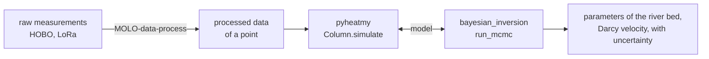

# MOLONARI-computo — developer guide

This page is for the people who work on the tree. The [README](../README.md) at the root is the guide of the users of
the software.

MOLONARI stands for "**mo**nitoring **lo**cal des échanges **na**ppe-**ri**vière", the local monitoring of
stream-aquifer exchanges. A MOLONARI device measures, in a river bed, the temperatures at several depths between 0
and about 40 cm and the head difference between the river and the aquifer. From these measurements, the exchanges of
water and heat between the river and the aquifer, and the properties of the river bed (permeability, porosity,
thermal conductivity), are estimated.

MOLONARI-computo is the computing part of MOLONARI: it takes the processed measurements of a monitoring point, solves
the transport of heat and water in a 1D column of the river bed, and estimates the properties of the river bed by a
Bayesian inversion (MCMC), with their uncertainty. The other parts of MOLONARI (the devices, their programming and
the visualisation software Molonaviz) are in [MOLONARI1D](https://github.com/flipoyo/MOLONARI1D).

## The tree

MOLONARI-computo is a tree of five Git repositories, described by [`molo-computo.cgs`](../molo-computo.cgs) and managed
with [ComplexGitSync](https://github.com/flipoyo/ComplexGitSync). This repository is its root; `cgitsync` places the
four others next to the files of the root:

| Path | Repository | Content |
|---|---|---|
| `MOLO-pyheatmy` | [MOLO-pyheatmy](https://github.com/flipoyo/MOLO-pyheatmy) | `pyheatmy`, the direct model: transient transport of heat and water in a 1D column of the river bed (`Column`, `Layer`, `Column.simulate`) |
| `MOLO-bayesian` | [MOLO-bayesian](https://github.com/flipoyo/MOLO-bayesian) | `bayesian_inversion`, the MCMC (DREAM, random walk Metropolis) that estimates the parameters of a model from its measurements; for a column, `run_mcmc(column.simulate, ...)` |
| `MOLO-data-process` | [MOLO-data-process](https://github.com/flipoyo/MOLO-data-process) | `molonari-pipeline` (`raw_to_processed`), the reproducible processing of raw measurements (HOBO exports, LoRa messages) into the processed data the direct model reads |
| `MOLO-tuto-cmpt` | [MOLO-tuto-cmpt](https://github.com/flipoyo/MOLO-tuto-cmpt) | tutorials: a synthetic data set generated with `pyheatmy`, its Bayesian inversion, and the inversion of the real data of `Point034` |

`pyheatmy` and `bayesian_inversion` do not import each other: the model given to the MCMC is any function, here the
direct model of a column.



## Installation

Two tools are needed: [Git](https://git-scm.com) and [pixi](https://pixi.sh). Every repository of the tree is
installed with pixi.

**1. The tree.** Install [ComplexGitSync](https://github.com/flipoyo/ComplexGitSync) in a clone of its own, then
clone the tree from `molo-computo.cgs`:

```sh
git clone https://github.com/flipoyo/ComplexGitSync.git
cd ComplexGitSync
pixi install
pixi run cgitsync bootstrap <path to>/molo-computo.cgs
```

`bootstrap` clones the five repositories at their place in a new workspace, every one on the branch `merge`, and
prints the `export CGSHOME=...` line of the workspace.

**2. The environment.** At the root of the tree:

```sh
pixi install          # Python and the three packages of the tree, installed in editable mode
pixi run test-all     # the tests of pyheatmy, bayesian_inversion and molonari-pipeline
pixi run lab          # JupyterLab in MOLO-tuto-cmpt, to run the tutorials
pixi run test-tuto    # runs the three tutorials (the two MCMC take about four minutes each)
```

The `pixi.toml` of the root installs the packages from the repositories next to it, so that a change in one of them
is seen at once by the others and by the tutorials. Each repository also has a `pixi.toml` of its own, to work on it
alone (`pixi install`, then `pixi run test`); the one of `MOLO-tuto-cmpt` installs `pyheatmy` and
`bayesian_inversion` from GitHub.

## Working on the tree

The tree has a single branch, `merge`, followed by every repository. The usual cycle runs each Git operation across
the five repositories at once, from anywhere inside the tree (see the
[tutorials of ComplexGitSync](https://github.com/flipoyo/ComplexGitSync/tree/main/tutorials)):

```sh
pixi run --manifest-path <path to>/ComplexGitSync/pixi.toml cgitsync status
pixi run --manifest-path <path to>/ComplexGitSync/pixi.toml cgitsync add
pixi run --manifest-path <path to>/ComplexGitSync/pixi.toml cgitsync commit -m "..."
pixi run --manifest-path <path to>/ComplexGitSync/pixi.toml cgitsync push
```

## History

MOLONARI-computo comes from the `pyheatmy` folder of [MOLONARI1D](https://github.com/flipoyo/MOLONARI1D), developed
by students of Mines Paris – PSL during the MOLONARI editions since 2021. In 2026, it was split into the repositories
of this tree. The former content of this repository (`pyheatmy` 0.9.7, the demonstration notebooks, the descriptions
of the sensors and the research notebooks of the 2023 to 2025 editions) is in its history, at the tag
`MOLONARI-computo-1`.

## Contributors

Project manager: Nicolas Flipo (nicolas.flipo@minesparis.psl.eu).

Student contributors to `pyheatmy`, its MCMC and their tutorials, by MOLONARI edition:

| Edition | Contributors |
|---|---|
| 2021 | Mathis Bourdin, Youri Tchouboukoff (authors of `pyheatmy`) |
| 2022 | Guillaume de Rochefort, Loris Megy, Valentin Alleaume, Amélie Impéror, Antoine Poirier, Paul Bonin Ciosi, Xinbei Jiang |
| 2023 | Mattéo Leturcq-Daligaux, Nicolas Matte, Mathis Chevé, Zhan Jing, Dan Maurel |
| 2024 | Martin Jessenne, Ombline Brunet, Alexandre Noël, Jordy Hurtado Jimenez, Aurélie Reynaud, Antoine Bourel de la Roncière, Colin Drouineau |
| 2026 | Yunus Emre Aydogan |

The tutorials credit in particular:

- Guillaume de Rochefort (2022), for the first notebooks that generated temperatures in the river bed with the direct
  model and `synthetic_MOLONARI`, which Nicolas Flipo developed further in 2024 (tutorial 1);
- Mattéo Leturcq-Daligaux (2023), who brought the DREAM MCMC into `pyheatmy`, and Martin Jessenne (2024), who
  corrected it (tutorial 2);
- Yunus Emre Aydogan (2026), who wrote the inversion of the real data of `Point034` for `pyheatmy` 0.12 and
  `bayesian_inversion` 0.4 (tutorial 3).

The contributors to the other parts of MOLONARI are listed in
[MOLONARI1D/contributors.md](https://github.com/flipoyo/MOLONARI1D/blob/main/contributors.md).

## Versioning

The version follows [SemVer](https://semver.org). `[workspace] version` in `pixi.toml` is the reference;
`scripts/bump_version.py`, the same in every repository of the MOLONARI-computo tree, writes it into every file that
mirrors it:

```sh
pixi run bump-version minor --dry-run   # print the plan, write nothing
pixi run bump-version patch             # or minor, major; --stage rc adds a pre-release label
pixi run check-version                  # every mirror holds the version of pixi.toml
```

## LLM assistance

Parts of this tree (its organisation into repositories, the pixi environments and this README) were written with
the help of large language models, mainly Claude (Anthropic) with Claude Code, used as a paid service under the
direction of the project manager. They are acknowledged here rather than credited as co-authors.

## License

MIT, see [LICENSE](../LICENSE). Each repository of the tree carries its own license.
